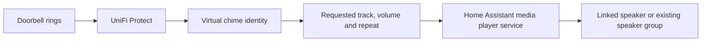

# Protect AnyChime — project overview

Last reviewed: 5 November 2026. Source release: **0.3.45 / measure1**.

## Purpose

**Any speaker can be a chime.** AnyChime is an experimental Home Assistant app that makes compatible HA media players appear as adoptable PoE chimes in UniFi Protect. It is an independent project, not an official Ubiquiti product. Its scope is broader than any single speaker manufacturer.

A speaker or an existing HA speaker group becomes **one virtual chime**. Protect owns the doorbell association, sound selection, chime volume and repetition. AnyChime receives the Protect request and forwards the requested sound to the corresponding HA player or group.

The slogan describes the goal. Actual compatibility depends on whether the HA integration can play a reachable audio URL. Having a speaker inside a device does not, by itself, expose that capability through HA.

## User experience

- English interface with **List** as the initial view and **Tiles** as an alternative.
- Separate **Chimes in Protect** and **Available speakers** sections.
- Add using **+** or drag and drop; no selection checkboxes or Save button.
- Existing HA groups appear as one block and one Protect chime.
- **×** removes the owned virtual device from Protect, then returns its speaker to Available. Physical speakers and HA groups are preserved.
- Offline available speakers are inactive, sorted below online speakers, and show an information tooltip instead of **+**.
- An added speaker can remain listed while offline. Its virtual chime disconnects and later returns with its existing identity.
- Show announcement capability reported by HA: supported, not supported, unknown, or varying across group members. This is capability reporting, not an acoustic test.
- Product images come from UniFi's catalogue where possible. Displayed speaker names and device labels are preserved.
- Protect account credentials belong in the app's HA Configuration tab. Routine certificate and network handling stays behind the scenes; the console address is secondary information.

## System flow



Protect discovers the virtual devices on the LAN, adopts them and communicates with the emulated chime protocol. Each virtual device maintains its own identity and ringtone storage. Uploaded Protect tracks are served locally so HA players can fetch the selected audio. AnyChime uses HA's Core API through Supervisor; it does not reuse the credentials or internal state of an installed HA UniFi Protect integration.

## Code map

| File or directory | Responsibility |
| --- | --- |
| `config.json` | HA app metadata, version, ingress, permissions and configuration schema. |
| `Dockerfile` | Python 3.13 Alpine image, networking utilities, FFmpeg and aiohttp. |
| `app/server.py` | Ingress UI, app endpoints, local media serving and runtime startup. |
| `app/index.html` | Speaker discovery interface, groups, add/remove actions and status. |
| `app/speakers.py` | HA discovery metadata, eligibility, availability, group interpretation and saved selection. |
| `app/registry.py` | Stable active entity/group-to-chime mappings and confirmed removal lifecycle. |
| `app/runtime.py` | Reconciliation of devices, availability, networking, adoption and Protect names. |
| `app/native.py`, `app/ucp.py` | Emulated chime state, controller connection and protocol messages. |
| `app/discovery.py` | Allowlisted LAN discovery and responses during a recent Protect scan. |
| `app/network.py`, `app/dhcp_hook.py` | Owned virtual network interfaces, DHCP and cleanup. |
| `app/connection.py`, `app/configuration.py` | Console detection, certificate trust and configuration handling. |
| `app/management.py` | Local Protect login and narrowly scoped management of verified app-owned chimes. |
| `app/ringtones.py` | Default/custom track storage, validation and track manifests. |
| `app/playback.py` | Translate a Protect request into bounded HA playback, including repetitions. |
| `app/audio.py` | Player preflight, announcement selection and normal playback fallback. |
| `app/announcement_sync.py` | Bounded alignment of initial group-announcement downloads. |
| `app/artwork.py`, `app/assets/` | Product catalogue matching, aliases, related images and bounded image cache. |
| `app/onboarding.py` | Legacy sound adapter retained for compatibility tests; speaker setup no longer invokes it. |
| `app/migration.py` | Compatibility with earlier app configuration/layouts. |
| `app/test_*.py` | Tests using mocked service boundaries; no real speaker playback. |
| `README.md`, `DOCS.md` | Setup, operation and more detailed user documentation. |
| `ASSETS.md` | Artwork provenance and asset notes. |
| `CHANGELOG.md` | Release history. |

## Identity, grouping and removal

Active chimes retain stable identities through app restarts and updates. A coordinator change does not require a new group chime. Group interpretation uses HA membership reports; unrelated or inconsistent reports do not automatically become a group.

Removing a chime in AnyChime requires verified removal in Protect before local identity cleanup. Ownership checks use the saved MAC, device type and UUID where available. Errors retain recoverable pending state. Confirmed cleanup purges the removed mapping, private identity material, ringtone storage and app-owned network state. Re-adding a removed speaker creates a fresh identity.

A removal command received from Protect deselects the corresponding group in AnyChime. An offline device cannot receive that command; a network outage alone is never treated as deletion. Historical records can only be automatically removed when saved ownership can be established.

## Audio behavior and synchronisation

1. Protect supplies the track number, volume and repetition count.
2. AnyChime verifies the configured target and current group membership.
3. Supported players receive HA `announce: true` with a separate requested announcement volume. AnyChime does not change their music volume first.
4. Sonos announcements are local to each speaker, so a Sonos group is targeted through its reachable, unmuted members in one HA service request. Other integrations retain their coordinator/group behavior.
5. Players without announcement support use the existing normal playback route, which can replace current music. A failed announcement is not retried as ordinary playback.

The default behavior is to **retain announcements** rather than replace music with a temporary group playback session. Snapshot/restore group playback was investigated but is not implemented or enabled.

For Sonos group announcements, each ring gets a unique local media URL. The media server holds an early initial audio download until the other distinct speaker clients arrive, for at most **300 ms** from the first participating download. It releases early when all expected clients are ready. HEAD requests, tiny byte-zero probes, duplicate clients and later byte ranges do not artificially complete the arrival count. Repetitions have separate batches. Audio responses disable small TCP packet buffering where the OS supports it.

This aligns **audio delivery**, not speaker clocks. Firmware, decoder behavior, network throughput and speaker buffering can still produce audible skew. A missing client, a fetching proxy or a full alignment pool must not indefinitely delay playback. There is no promise of sample-accurate group announcements.

`extra.volume` support and automatic resumption depend on the HA integration and device firmware. Some older devices may accept an announcement request but fall back internally. Successful HA acceptance is not proof of acoustic playback or restoration.

## Product image matching

Matching considers manufacturer, model, model identifier, original HA device name and an explicit physical parent device where available. It never borrows an unrelated connectivity hub's identity or treats an unqualified numeric model ID as globally unique.

The search prefers exact matches and known alternative hardware names, then explicit related models or an unambiguous generation in the same manufacturer's product family. Examples include Apple TV 4 / A1625 → Apple TV HD, and an illustrative Sonos One image for One SL. Approximate images are identified in tooltips and the footer. Unknown or ambiguous products retain a generic device icon.

Images are downloaded from a fixed official UniFi image origin, validated and cached in app data. Speaker labels and playback targets do not change to match the image.

## Installation and normal use

The app currently ships as a **local HA app**, with slug `unifi_anychime` and installed identifier `local_unifi_anychime`. Supported architectures are `aarch64` and `amd64`.

1. Place the app directory in Home Assistant's local app source directory and refresh the app store.
2. Install Protect AnyChime, start it and open its web interface.
3. Configure a local UniFi account with Protect Full Management in HA's Configuration tab if app-side management/removal is needed. This is HTTPS login, not SSH; cloud SSO/MFA is not implemented.
4. Add a reachable compatible speaker or group using **+** or drag and drop.
5. Adopt the virtual chime in Protect, associate it with a doorbell and choose its ringtone, volume and repetitions there.

Use normal HA update controls for subsequent versioned releases. App source/config changes do not update a running container by themselves. Refresh the local store, perform the offered app update and verify the running version afterward. Normal user operation should not require a terminal.

This directory is the portable development source. Deploy it to the local Home Assistant app source directory using the supported file-sharing or repository workflow. Runtime installation data belongs in HA app storage, never in the source checkout.

## Networking, permissions and trust

The app uses host networking, HA Core API access and `NET_ADMIN` / `NET_RAW` for its virtual interfaces. It does not request Supervisor management API access through its app manifest. The web interface uses HA ingress on port **48200**, which also serves bounded local media routes. Each native management listener binds a free port on its dedicated chime IP. A narrowly scoped forwarding rule exposes it as port 8080 only for the configured Protect console on the owned chime address. Host port 8080 is not reserved, including when another app has a wildcard listener. Forwarding rules are persisted for owned cleanup; other host rules are never flushed. Speakers must be able to reach the media address. LAN device discovery uses UDP **10001**.

All virtual chimes, including the primary identity, use owned interfaces and DHCP addresses. Network cleanup checks ownership before removing resources. The advertised firmware is a compatibility profile, not installed UniFi firmware. Physical UniFi firmware must never be installed in this virtual app; update AnyChime through HA.

Console certificate pins and private identity material are handled internally. Management credentials are not returned to the browser. Do not copy runtime options, passwords, private keys or HA access tokens into this source tree or troubleshooting output.

## Persistence and backups

HA app data contains saved selections, chime mappings and identities, certificate trust, network state, custom ringtones and downloaded product images. App configuration includes the optional local Protect credentials. Use HA's standard app backups, including AnyChime. The manifest requests **cold backups** so the app is stopped while data is captured.

Restoring a backup restores identity material. The previous instance must be stopped before an identical restored instance starts; two active copies must not advertise the same virtual devices. There is no separate user-facing export/import requirement.

## Validation and current evidence

- Tests use independent generated self-signed certificates, synthetic LAN addresses and synthetic audio bytes, never a real installation certificate or recording.
- Native connection, adoption, track control, upload, deletion, artwork and announcement timing are covered by mocked transport tests.
- Download-alignment simulations measure server delivery only, not acoustic synchronization.
- Acoustic playback, restoration and perfect synchronization are never inferred from successful HTTP/service calls.
- Adding, refreshing and grouping speakers are silent; actual playback is initiated by Protect.

Run the Python suite from the project directory:

```sh
python3 -m unittest discover -s app -p 'test_*.py'
```

Some protocol tests require the runtime Python dependencies installed by the Dockerfile. HA/Sonos services, firmware endpoints and network mutation boundaries are mocked in the test suite.

## Known limits and next work

- This is protocol emulation developed against Protect 7.3.70. Future Protect releases may change discovery, adoption, update reporting or control behavior.
- No guarantee that every HA media player can accept an arbitrary gong URL. Native UniFi devices and known incompatible integrations are excluded.
- Separate announcements cannot be forced onto a common playback clock through the currently used Sonos API. Further timing work should measure request, download and acoustic timing rather than assume simultaneous calls mean simultaneous sound.
- Generic queue-item deletion and universal music snapshot/restore are not implemented. Clearing an entire music queue is not an acceptable substitute for removing only a gong.
- Automatic product artwork depends on available metadata and catalogue coverage; similar-model images may be used as labelled illustrations.
- No automatic Bluetooth pairing, generic BLE audio proxy, Matter/Thread speaker transport or standalone firmware-based tamper-siren control is part of this app.
- This folder contains the complete current local app source, not a published add-on repository or an automated release pipeline.

## Primary references

- [HA media playback and announcement support](https://www.home-assistant.io/actions/media_player.play_media/)
- [HA Sonos integration](https://www.home-assistant.io/integrations/sonos/)
- [HA Sonos implementation](https://github.com/home-assistant/core/tree/dev/homeassistant/components/sonos)
- [Sonos AudioClip command](https://docs.sonos.com/reference/audioclip-loadaudioclip-playerid)
- [Apple model identity reference](https://support.apple.com/en-us/101605)

See `CHANGELOG.md` for release-by-release behavior and `ASSETS.md` for artwork provenance. Verification artifacts live in the parent `outputs` directory, outside the installable app folder.


## Portable certificate and ringtone handling

No console certificate, fingerprint, fixed LAN address, device identity or recorded ringtone is included in the app source. Console discovery uses runtime network information, with a manual address available in setup. Confirmation stores the console certificate privately in `/data`; native mTLS and management HTTPS use installation-specific trust. A legacy pin-only installation may recover the public certificate only when it matches its already saved pin. Certificate changes are not automatically trusted.

The ringtone store starts empty. Protect's normal connection sequence queries `getAudioInfo` and uploads missing in-track default/custom audio through `/api/uploadRingtone/<track>/<filename>`. AnyChime caches the actual received bytes in HA app data. Ring commands select those cached bytes by track number. No substitute Ubiquiti recording or firmware-derived confirmation sound is bundled. See `PUBLICATION.md`.


## Native management and test-button compatibility

All chimes, including the primary identity, obtain a dedicated DHCP address. Their HTTPS management listeners use a free internal port, with an owned forwarding rule exposing port 8080 only on that owned chime address and only to the configured console. The app does not bind the HA host's TCP port 8080. The rules are narrow, placed in per-chime nftables tables with prerouting priority -110 (before the standard Docker destination NAT priority -100), persisted for cleanup and never implemented by flushing unrelated host rules. The existing NET_ADMIN capability is used; no additional capability or protection-mode change is requested.

Protect's `playBuzzer` command uses the same uploaded-track forwarding path as `playSpeaker`, including its supplied track number. When omitted, track 1 is used. This emulates a buzzer/test button using console-delivered audio, not a separate bundled buzzer recording.

Certificate inspection and trust changes require the HA ingress proxy source. Loopback requests and forged forwarded-source headers do not bypass this check.


HA stop/restart signals trigger owned network cleanup before exit. The app allows a 30-second shutdown grace period. If the host kills the process abruptly, private ownership records permit exact cleanup/replacement on the next start.


Management forwarding preserves the dedicated chime destination IP using DNAT and changes only its TCP port. REDIRECT is not used for new rules because its incoming-interface address substitution can select the HA host address. Legacy owned rules are cleaned up using their saved rule format.


## Firewall portability

The app ships its own `nft` userspace tool and uses the host kernel's nf_tables NAT interface directly. It does not select or change the host's iptables alternative. Standard Docker iptables-legacy, iptables-nft and native nftables configurations therefore share the same app path. Each chime has a hash-named IPv4 table containing exactly one NAT base chain and one console-source/chime-destination/TCP-8080 DNAT rule. No Docker chain or global policy is edited. The priority is -110, after conntrack and before standard dstnat (-100).

Linux 4.18 or newer is required for coexistence with legacy iptables NAT. Kernel nftables/NAT modules and NET_ADMIN must be available in the host network namespace. Missing tools, permissions and rejected kernel transactions fail explicitly; the app does not load modules, change alternatives or disable host security. A custom host firewall can still reject traffic or install an earlier NAT rule. macvlan/DHCP and a suitable LAN interface remain independent requirements. This is not a promise of support for rootless Docker, Docker Desktop or every host firewall.

Changes are kernel-checked with `nft --check` and then committed in one atomic batch. Active and pending descriptions are journaled privately for recovery from termination between commit and journal finalisation. Existing objects are compared with the expected complete table, chain and rule; only kernel handles and the metainfo record are ignored. Extra objects or changed expressions prevent removal. Old iptables rules are validated and removed only after successful nft installation. The new implementation never blindly tries both iptables backends.

Automated tests simulate the kernel and verify transactions, ownership, migration and failure paths. Separate real-host integration runs are required for HA OS, Debian/Supervised with legacy Docker, Debian with nft-compatible Docker and native Docker nftables. Keep untested combinations labelled unverified.

References: [Docker nftables ownership and priorities](https://docs.docker.com/engine/network/firewall-nftables/) and [Netfilter NAT coexistence since Linux 4.18](https://wiki.nftables.org/wiki-nftables/index.php/Performing_Network_Address_Translation_(NAT)).

Validation on 5 November 2026: release 0.3.38 installed on one HA OS host; both existing chimes remained adopted and connected after migration and a further normal restart. TLS 1.3 handshakes from the console to each chime's port 8080 succeeded before and after the restart. No playback request was sent. 270 Python tests and the release hygiene check passed. Debian/Supervised and the other Docker backend combinations have not been tested on real hosts.


## Physical product information and artwork

Discovery reads the products associated with HA state entities (up to 512 device registrations) in the same bounded Core API template request as speaker discovery. It retains product manufacturer, model, model ID and original device name plus temporary hardware relationship fields. No speaker label or playback target is changed. Direct product and explicit physical-parent matches take precedence; cross-registration matching requires an exact connection/identifier or an unambiguous serial match within the same manufacturer. Similar names, shared rooms and hub connectivity do not establish identity.

When HA exposes no physical link, clicking the speaker image opens an English product chooser backed by actual HA product metadata. The explicit choice is saved in `/data/product-links.json`, tied to the original speaker device ID to prevent reuse by a different device with the same entity ID. It is included in the app's normal cold HA backup. Hardware identifiers and serials are not returned by the product-list endpoint or saved in the choice file. Both new product endpoints require authenticated HA ingress. Choosing Automatic removes the explicit link.

A richer product title can identify a retail brand and a unique alphanumeric catalogue model code despite community firmware reporting another manufacturer. Such a match is labelled as an illustrative image; ambiguous codes retain the generic icon. This does not add hardcoded rules for the developer's devices. A missing physical link still needs an explicit choice rather than a guessed camera association.


## Explicit chime actions

Added chimes expose Test chime and Remove in an anchored actions dialog, with the existing removal confirmation retained. The test action requires an explicit confirmed ingress POST, a local Protect management account, and a uniquely matching owned, online and adopted Protect chime. The account session is certificate-pinned. The only new allowed Protect operation is bodyless POST to the validated chime ID's `/play-speaker` route, so Protect remains the source of test track, volume and repetition. Tests use Protect's general test settings, which may differ from a paired doorbell's ring settings. The UI does not issue tests from opening the menu, refreshing metadata or loading the app. Acknowledging a test request does not claim acoustic playback succeeded.


Validation on 5 November 2026 for 0.3.40: 285 Python tests, JavaScript syntax and release hygiene checks passed. Installed through HA's official Apps client. Both chimes are connected and adopted. The richer discovery query returned the speaker registrations and physical product inventory; the artwork-only choice persisted across the update and its catalogue image loaded successfully. Browser measurements confirmed one sidebar panel, no duplicate sidebar image, equal 13 px paragraph text / 21.45 px line height, two action menus, no direct remove buttons, correctly ordered List/Tiles controls, and no horizontal overflow in desktop List/Tiles or a 390 px List viewport. The live actions dialog exposed Test chime and Remove with vector icons and fit the viewport. No playback command was sent by the agent; the live test endpoint was not invoked during verification.


## Announcement alignment and diagnosis

The group audio response is held before its headers as well as its body. The shared deadline is one second from the first qualifying download, with immediate release when all expected distinct peers arrive. HEAD requests, tiny probes and later ranges do not wait or count. This changes only the existing local grouped-announcement delivery path, retaining announcements and their music-preservation behaviour. No extra play, volume or grouping action is issued.

Private timing batches live for up to 60 seconds (maximum 64 batches, maximum 32 recorded peers each). The playback status exposes only expected/observed download counts, arrival spread, wait limit and release reason; media URLs, tokens and addresses are omitted. Late arrivals after a timeout remain visible in those metrics. These are delivery measurements, not microphone measurements or proof of acoustic synchronisation. If buffering/decoder clocks differ, speakers can remain audibly offset. No automatic audio test is performed during upgrades or diagnostics.


Validation for 0.3.41 on 5 November 2026: 290 Python tests, JavaScript syntax and release hygiene checks passed. Both installed chimes remain connected and adopted. Browser checks confirmed Remove's computed RGB colour matches the host HA error colour. Two fully intercepted browser test requests (success and rejection) left the menu open and re-enabled its test control; no real test request or audio command was sent. Group-delivery regression tests cover a second download arriving after the former 300 ms limit, response-header ordering, bounded timeouts, late-arrival metrics, cancellation and private status output. No live acoustic group test was performed; the new timing metrics were still empty at the final status read.


## Chime-only separation and combination

A recognised, consistently reported HA group defaults to one Protect chime. Its added-chime menu offers Separate chimes; each resulting member offers Combine chimes when all members of that HA group are added. The UI confirms that existing Protect chimes will be removed and the replacements must be adopted and paired to a doorbell again. No HA join, unjoin, media-group or playback operation is used for the conversion. Individual audio routing still depends on the HA integration: Sonos announcements are local AudioClips, whereas another integration may route a member's playback to its group coordinator.

`/data/chime-layout.json` stores only chime grouping preferences and, during a conversion, the target member set, intended selection, old local keys and the removal/commit phase. A read-only, pinned Protect ownership check runs before persisting a transition or pausing existing devices. All old scoped identities (including inactive historical identities that might otherwise be reused) are removed and purged before replacements are allocated. An entry with membership outside the requested set is not silently deleted. Unrelated chimes retain their identity and adoption.

Pending transitions suppress affected discovery/reconciliation and automatic regrouping, and block conflicting selection changes. The UI provides Resume change after an interrupted or partially completed removal. The journal switches to committing before preferences or replacement mappings are written, so restart/retry cannot delete newly created identities reusing an old local key. New native identities stay disabled until the commit finishes. The HA cold app backup includes this state; the existing explicit transfer format now includes layout preferences and artwork associations too.

For test playback, the app sends explicit volume/repeat/ringtone values read from paired Protect ringSettings. A single paired setting, or multiple identical settings, is unambiguous. With conflicting doorbell settings the test is refused instead of choosing a possibly louder profile. With no paired doorbell, the general Protect chime settings are used; no missing volume defaults to 100%. Volume 0% returns a muted result without an audio command. This supersedes the earlier general-settings-only test behaviour.


## HA-style drag UX

The UI bundles SortableJS 1.15.7 (MIT), matching the inspected HA frontend dependency, with 150 ms animation, a dedicated six-dot handle, blue translucent ghost, raised drag card and auto-scroll. It follows the interaction pattern of HA's automation action list, adapted to Available → Chimes in Protect transfer rather than automation reordering. The explicit + action remains available. No external script CDN is used; only the fixed local vendor asset route is exposed.

The old HTML5 whole-card drag handlers are replaced by connected Sortable lists. A placeholder restores the original card position before an asynchronous add request, and server confirmation determines the final selected section. List polling/rendering pauses during a move; a cancelled move does not call the backend. Unavailable members and pending layout transitions cannot start a drag. Pointer, touch and keyboard paths share the existing add/validation endpoint; keyboard Space picks up, Enter commits, Arrow Up focuses the drop area and Escape cancels, with live announcements for assistive technology.

References: [HA automation action list](https://github.com/home-assistant/frontend/blob/dev/src/panels/config/automation/action/ha-automation-action.ts), [HA sortable component](https://github.com/home-assistant/frontend/blob/dev/src/components/ha-sortable.ts). The library tarball integrity and extracted asset attribution are recorded in ASSETS.md. This does not change HA automations or speaker grouping.


## Measurement-only calibration (phase 1)

Open a chime's actions menu → **Diagnostics & calibration**. Ordinary rings now record the native request receipt, HA play request send/response, and per-speaker-IP first GET plus server response-write completion. Diagnostics keep the most recent 128 records in memory; they are not permanent logs and contain local IP addresses. The dedicated diagnostics endpoints require authenticated HA ingress. A completed server write does not prove the speaker received, decoded or sounded the audio. Group rings use the existing unique `ac_sync` request tokens; stable singleton URLs use explicitly labelled path/timing heuristics. Cached or proxy downloads can be absent or ambiguous. Normal audio URLs, gain, repeat scheduling and group routing remain unchanged.

Calibration is optional and never runs on load, refresh or upgrade. Open HA over HTTPS, Nabu Casa, or a secure Companion-app session; plain LAN HTTP cannot use getUserMedia. Press **Start calibration — 5 clicks per speaker** yourself and allow microphone access. This authorises that finite sequence only. The app generates a short synthetic click and sends each member five separate requests, one member at a time, through the existing SpeakerBackend/play_media adapter. Keep the microphone in one fixed position, the room quiet and other audio stopped. Sound travel adds approximately 3 ms per metre. Some HA integrations redirect a member request to its whole group; stop if an unintended member also sounds. Stop, close or leaving the tab prevents further trial requests; an already sent click cannot necessarily be recalled.

Microphone processing runs locally in an AudioWorklet with a 3 kHz bandpass and an onset threshold above the observed noise floor. Only onset measurements are sent back, never recordings or microphone sample arrays. Five clock pings estimate the browser/server monotonic-clock offset using the lowest round-trip delay. The app records both browser-request-to-onset and estimated HA-send-to-onset latency, together with clock uncertainty. Microphone capture/processing latency, position, threshold and room noise remain part of the measurement. These are estimates, not proof of acoustic synchronisation.

After exactly five valid samples for every member, `/data/latency-calibration.json` stores the samples, mean, sample standard deviation, range and clock uncertainty keyed by HA device ID. It is included in the normal app backup. A cancelled, incomplete, noisy or interrupted session does not overwrite valid profiles. The synthetic click cache is separate from native ringtone storage. The result is measurement only: no value is applied to playback. Manual Delay fields, latency compensation, repeat rendering, alternative synchronised modes and parallel state fetching are deliberately deferred. Stop here and run a user calibration before further phases.

If HTTPS microphone access is unavailable, the UI explains the limitation and starts no sound. Manual delay controls belong to phase 2 and are not pretended to work in this release. Browser/platform microphone policy can still deny access even over HTTPS.

### Optional automatic adoption

In the app's HA Configuration tab, **Automatically adopt chimes in Protect** is off by default. Enabling it requires the configured local Protect account. Only a currently selected, enabled, newly discovered virtual PoE chime with the matching local MAC, host and identity can be adopted. Already adopted/adopting devices and foreign devices are not taken over. Attempts are bounded and spaced out. This option does not pair a doorbell or change sounds/volumes/repeats: finish those settings in the Protect app. No automatic adoption was enabled or tested on real devices during development.

Browser API references: [getUserMedia secure-context requirements](https://developer.mozilla.org/en-US/docs/Web/API/MediaDevices/getUserMedia), [AudioWorklet](https://developer.mozilla.org/en-US/docs/Web/API/AudioWorklet), [audio/performance clock mapping](https://developer.mozilla.org/en-US/docs/Web/API/AudioContext/getOutputTimestamp).

## Available groups and restoring an existing chime

The grouping menu is also available beside speakers in **Available speakers**. **Separate chimes** and **Restore original group** change only AnyChime's representation of an existing HA speaker group; they never call HA grouping services.

If none of the group members is selected, changing the layout creates no Protect chimes and needs no Protect management account. If exactly one chime represents the selected part of a separated group, restoring the group adds its remaining online members to that existing chime. Its key, identity files, adoption, doorbell pairing and stored ringtones remain intact, even when the added member is the HA coordinator. An offline new member cannot be added. Any old inactive identities are cleaned up using the existing confirmed-removal workflow; failures remain resumable and never replace the retained chime. If multiple separate chimes are already selected, the existing replacement workflow still applies and requires new adoption and pairing.

**Diagnostics & calibration** is hidden for one single-speaker chime with no other known chimes. It remains available for a multi-speaker group or multiple chimes. A local Protect account allows a read-only lookup of the total adopted chime count, including Ubiquiti's own chimes, cached for 60 seconds. When this lookup is unavailable, the UI uses known AnyChime entries and does not claim to have discovered native chimes. This only determines menu visibility: native Ubiquiti chimes cannot be calibrated through AnyChime's HA playback adapter. Latency compensation remains deferred until the user has performed phase 1 calibration.

## Quiet test playback

The AnyChime **Test chime** menu starts at **10%** every time it is opened. Adjust **Test volume** before pressing Test chime if needed. Changing the slider never starts audio. This override is sent only with the explicit Protect test request; it never changes saved Protect volume or the volume used by real doorbell rings. Ringtone and repeat settings still come from Protect. A 0% test volume or a muted Protect chime sends no playback request. Testing directly in Protect or Home Assistant's Protect integration continues to use that application's own controls.

## Manual latency compensation — local HTTP supported (0.3.48)

Open a chime's **Adjust timing** menu. Increase **Delay (ms)** for the speaker that sounds early; leave the slowest speaker at zero. Choose 0–500 ms, press **Save timing**, then explicitly press **Test at 10%**. Saving, editing, opening and refreshing never request sound. The test uses the configured Protect ringtone through the normal Protect test path, with a temporary 10% volume override. Saved delays apply to real rings too; their Protect volume is unchanged. Set all delays back to zero and save to restore the original playback route. This works over local HTTP and requires no microphone, domain, certificate or Cloud subscription. Optional microphone measurements remain under a collapsed advanced section and still require a secure browser context.

This is **latency compensation**, not a shared playback clock. Individual adjustment currently supports Sonos announcements with stable HA device IDs. Other integrations keep their existing playback route and show an explanation instead of offering unsupported controls. Settings are private in `/data/latency-delays.json`, keyed by HA device ID and covered by the app backup. No default delays are enabled on upgrade. Nonzero settings prepare every member's audio in the same PCM WAV format, with sample-exact leading silence at 48 kHz. Cached variants are keyed by ringtone MD5, offset and repeat=1, capped at 128 MiB; individual files are bounded at 25 MiB/120.5 seconds. Recently prepared variants are protected from eviction for two minutes; a full protected cache refuses playback rather than dropping media promised to a speaker. Original Protect ringtone files remain unchanged. Cache files can be regenerated after restore.

Compensated group requests are sent per member concurrently, while retaining a single bounded download barrier across all member URLs. Diagnostics correlate those paths to one ring. Announcements and music resumption are retained. Repetitions still use the existing separate-announcement path, with the configured leading silence included in the wait; combined-repeat rendering and alternate playback modes remain deferred. Network and device variability can still cause audible drift. [Sonos AudioClip supports MP3 and WAV](https://docs.sonos.com/reference/audioclip-loadaudioclip-playerid).

The grouping menu now remembers explicitly known Sonos sets when HA later reports their members as separate. **Restore original group** remains available and restores only the virtual chime layout, never the HA music group. A partially selected set retains its existing chime; replacing multiple selected chimes still requires the existing confirmation and re-adoption workflow. No live speaker grouping, removal or audio test is performed during development verification.

## Group selection without saved HA group history (0.3.49)

For an individual Sonos announcement speaker, open **Group chimes…** and choose the other members. This also works when HA reports each player as a singleton and AnyChime has no previous group to restore. Only individually addressable Sonos announcements are offered; existing multi-member HA music groups cannot be partially reconfigured here. Continue shows the same scope-aware confirmation: unused speakers create only a display preference, one existing selected chime keeps its identity/pairing when adding other members, and multiple selected chimes use the existing replacement/re-adoption flow. The new virtual set is remembered for later Separate/Restore actions. No HA group service is called.
